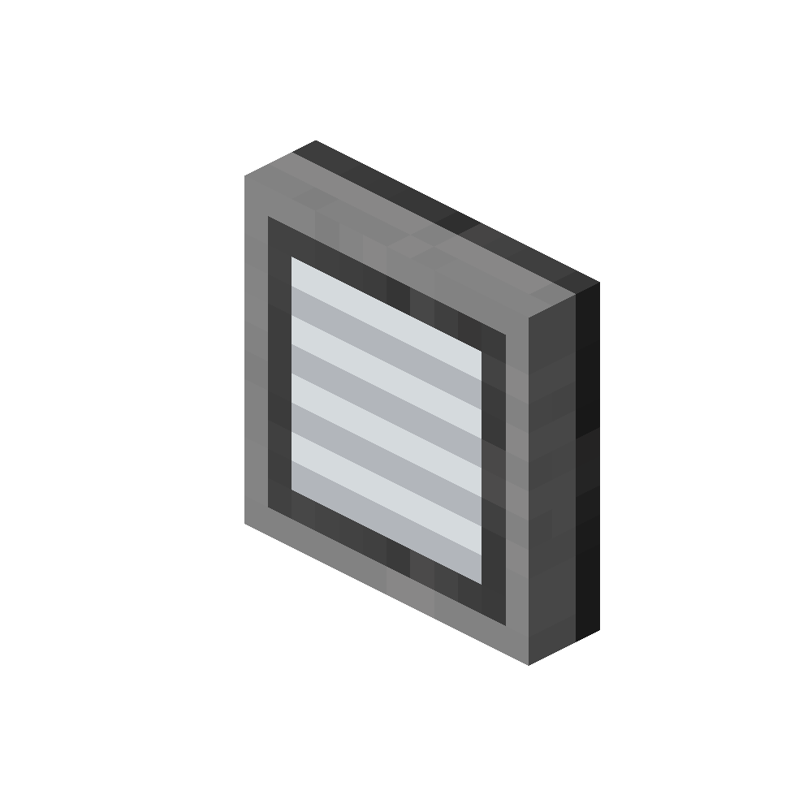

<div class="infobox" markdown>



| Label     | Value          |
|-----------|----------------|
| **ID**    | `presence_sensor` |
| **Since** | v0.6.7         |

</div>

The Presence Sensor detects living entities in its field of view with a default maximum range of **24 blocks** and returns their type and how far away they are from the peripheral.

## Methods

As all peripherals, the Presence Sensor can be interacted with through the `peripheral` API.

* `sense(): table` Sense entities within the sensor's range. See [Detected entity list](#detected-entity-list) for an example the returned list.

## Events

### `presence_sense`

This peripheral automatically scans by default every 10 ticks (half a second), both of these settings can be toggled in the configuration.

Upon detecting an entity, it emits the `presence_sense` event.

1. `string` - The event name. Always `"presence_sense"`.
2. `string` - The peripheral network name.
3. `table` - The list of entities with their types and distances. See [Detected entity list](#detected-entity-list).

## Detected entity list

```lua
{
    {
        type = "minecraft:player",
        distance = 3.14,    
    },
    {
        type = "minecraft:creeper",
        distance = 8.6,
    }
}
```